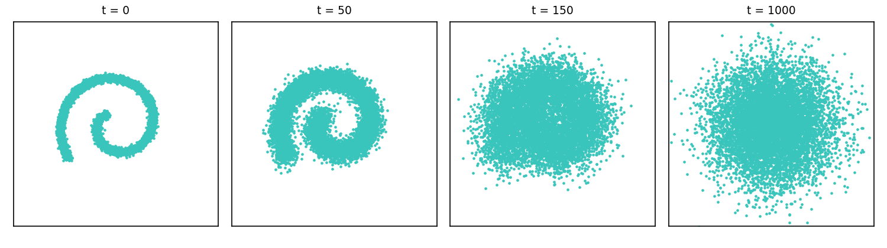

# Diffusion

A Denoising Diffusion Probabilistic Model (DDPM) implemented from scratch with PyTorch. Start with 2-D points (a spiral) before images: the mathematics is identical, yet training finishes in minutes on a CPU. The picture below shows visualisation of the forward process: Gaussian noise is added step by step until the spiral is destroyed and only pure static noise remains.



---

## Relation to Artificial Intelligence

Diffusion models are the engine behind the current wave of generative artificial intelligence (AI), for example, in Flux (text-to-image), Sora (video generation), audio and music models, as well as protein and molecule design. All of them implement the same core idea shown here: gradually add noise (forward process), train a network to predict that noise, then reverse the process to generate new samples. The only differences are the network architecture (e.g. U-Net or DiT instead of a MLP) and the data modality (e.g. pixels, latents, or spectrograms). When one calls `optimizer.step()` in PyTorch code (in JAX's Optax, `optimizer.update()`), the framework applies exactly the update rules derived in this project (gradient descent, momentum or Adam, e.g. `torch.optim.SGD` and `torch.optim.Adam`) to every parameter of the model, using the gradients that backpropagation has just computed.

## Running

```bash
pip install -r requirements.txt
python diffusion.py
```

## Mathematics

<ins>1. Forward process</ins>

Take a real data point $x_0$ and add a little Gaussian noise $T$ times. A fixed noise schedule $\beta_1,\dots,\beta_T$ (here linear from $10^{-4}$ to $0.02$) controls how much noise is added as

$q(x_t \mid x_{t-1}) = \mathcal{N}\!\left(x_t;\ \sqrt{1-\beta_t}\,x_{t-1},\ \beta_t I\right)$.

This is a Markov chain: $x_t$ depends only on the previous step. There is no learning, only a fixed formula. Eventually $x_T \approx \mathcal{N}(0, I)$ — pure static noise.

<ins>2. Jump to any timestep</ins>

Write $\alpha_t = 1-\beta_t$ and $\bar\alpha_t = \prod_{s=1}^{t}\alpha_s$. Because the sum of independent Gaussians is Gaussian (variances add), the chain can be closed as

$q(x_t \mid x_0) = \mathcal{N}\!\left(x_t;\ \sqrt{\bar\alpha_t}\,x_0,\ (1-\bar\alpha_t)I\right)$

or equivalently

$x_t = \sqrt{\bar\alpha_t}\,x_0 + \sqrt{1-\bar\alpha_t}\,\epsilon,\qquad \epsilon \sim \mathcal{N}(0, I)$.

This makes training cheap: there is no need to simulate $t$ steps; a noisy version is obtained in a single line (`q_sample`).

**Sanity check:** when $\bar\alpha_t \to 0$ the term $\sqrt{\bar\alpha_t}\,x_0$ vanishes and we are left with $\epsilon$. Variance stays 1: $\bar\alpha_t + (1-\bar\alpha_t) = 1$.

<ins>3. What the network learns</ins>

The reverse process $p_\theta(x_{t-1}\mid x_t)$ is approximated by a Gaussian. Ho et al. showed that it can be parameterised so that the network $\epsilon_\theta(x_t, t)$ predicts the **noise** that was added to the data point. The simplified training loss is mean-squared error

$L_\text{simple} = \mathbb{E}_{t,\,x_0,\,\epsilon}\Bigl[\,\bigl\lVert \epsilon - \epsilon_\theta(x_t, t)\bigr\rVert^2\Bigr]$.

The training loop is therefore:

1. Sample a data point $x_0$ and a random $t \in \{1,\dots,T\}$.
2. Draw $\epsilon \sim \mathcal{N}(0,I)$ and compute $x_t$ with the formula above.
3. Minimise $\lVert \epsilon - \epsilon_\theta(x_t,t)\rVert^2$.

The network receives the timestep $t$ as a sinusoidal embedding (the same idea as positional encoding in Transformers) so it knows how much noise to expect.

<ins>4. Sampling (reverse process)</ins>

Start from pure noise $x_T \sim \mathcal{N}(0,I)$ and walk backwards as

$x_{t-1} = \frac{1}{\sqrt{\alpha_t}}\Bigl(x_t - \frac{\beta_t}{\sqrt{1-\bar\alpha_t}}\,\epsilon_\theta(x_t,t)\Bigr) + \sigma_t z,\qquad z\sim\mathcal{N}(0,I)$.

Here $\sigma_t^2 = \beta_t$ and on the final step ($t=1$) no noise is added. Inside the parentheses the predicted noise is subtracted and the whole expression is scaled back. The added $\sigma_t z$ keeps the process stochastic, producing different samples on every run.

<ins>5. Why this works</ins>

The mean of the reverse step depends on the *score* function of the data distribution $\nabla_x \log p_t(x)$. Noise prediction is linked to it by

$\nabla_{x_t}\log q(x_t) \approx -\frac{\epsilon_\theta(x_t,t)}{\sqrt{1-\bar\alpha_t}}$.

The network therefore learns the direction in which a point should move to become more probable, and sampling is essentially taking small steps toward the data. This is the same principle used by Stable Diffusion and other image generators, even though there the network is a U-Net and the data are images (or latent representations of images).

## References

Weng, L. (2021). “What are Diffusion Models?”. Lil'Log. Available at: https://lilianweng.github.io/posts/2021-07-11-diffusion-models/